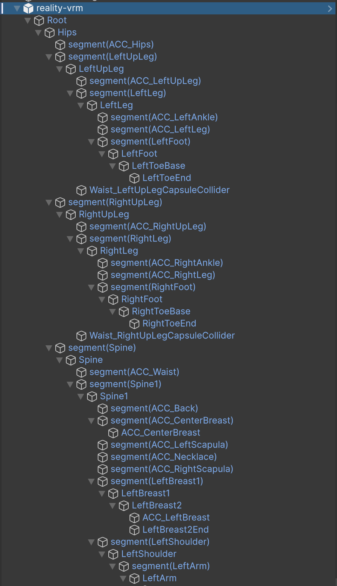

# vrm-segment-remove
REALITYから出力されたVRMのsegmented scale用中間GameObjectを除去するツールのリポジトリです

## 対象のVRM
REALITYから出力されたVRMは、Unity上でのセグメントスケール対応の都合上、Humanoidで参照されるボーンの間に
`segment(ボーン名)` という中間階層が1つ挟まっています。このツールはその階層を除去してVRMを出力し直します。



- Unity 6000.0.58f2
- UniVRM 0.55.0_ce1c

## Web版
ブラウザだけで動作します。VRMファイルはサーバに送信されず、すべてブラウザ内で変換されます。

1. 「Open VRM File」を押す、またはVRMファイルをページにドラッグ&ドロップ
2. 「Convert and Export」を押すと `<元のファイル名>-segment-removed.vrm` がダウンロードされます

### ビルド / 配信 (GitHub Pages)
- Unityメニュー `Tools > VRM Segment Remover > Build WebGL`、またはバッチ実行
  ```
  Unity -batchmode -quit -nographics -projectPath REALITYVRMSegmentRemover -buildTarget WebGL \
    -executeMethod VRMSegmentRemover.Editor.WebGLBuilder.Build
  ```
- 出力先はリポジトリ直下の `docs/` です。GitHub Pagesの設定で Branch=`main`, Folder=`/docs` を指定してください
- WebGL専用です (Windows/Macビルドは、ファイル選択プラグイン削除に伴い非対応)

## ライセンス
このリポジトリのソースコードは [MIT License](LICENSE) です。

以下のライブラリを含む/利用しています。それぞれのライセンスに従います。
- [UniVRM](https://github.com/vrm-c/UniVRM) (`Assets/VRM` 配下: UniGLTF, UniHumanoid, UniJSON, MToon, DepthFirstScheduler など。MIT)。WebGL対応のための最小限の改変を加えています
- [UniTask](https://github.com/Cysharp/UniTask) (MIT)
- [UniRx](https://github.com/neuecc/UniRx) (MIT)
